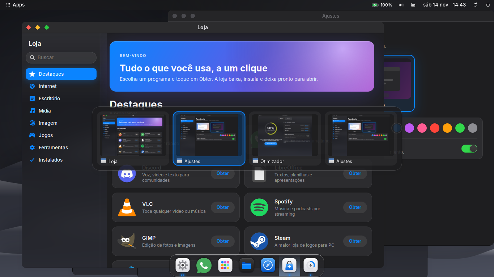
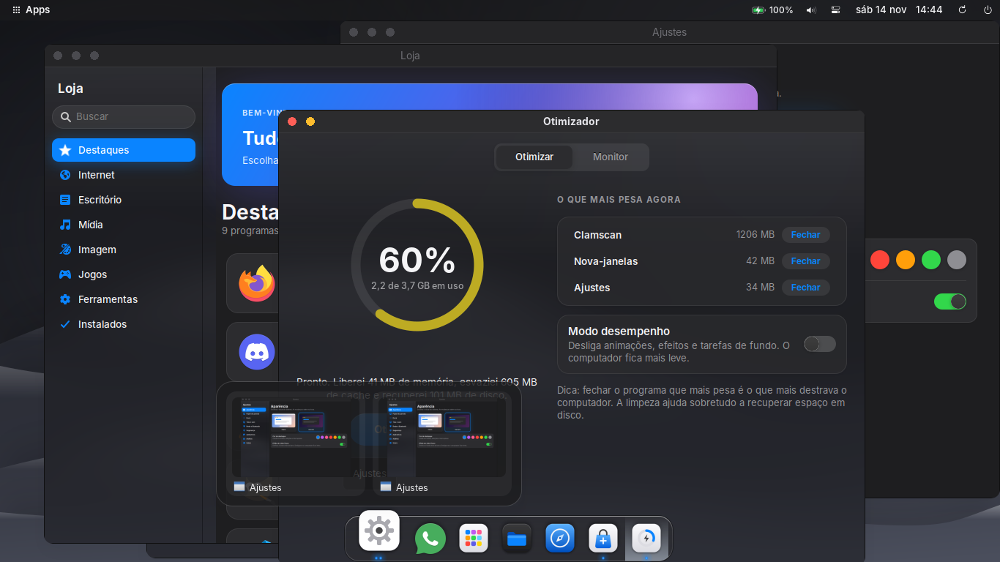
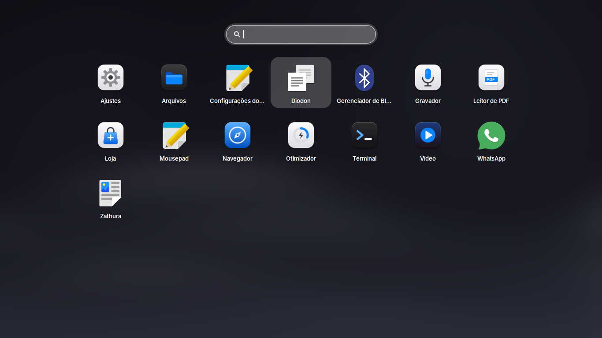
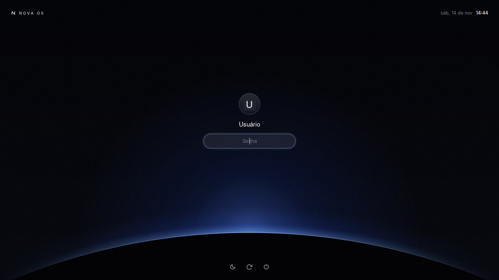
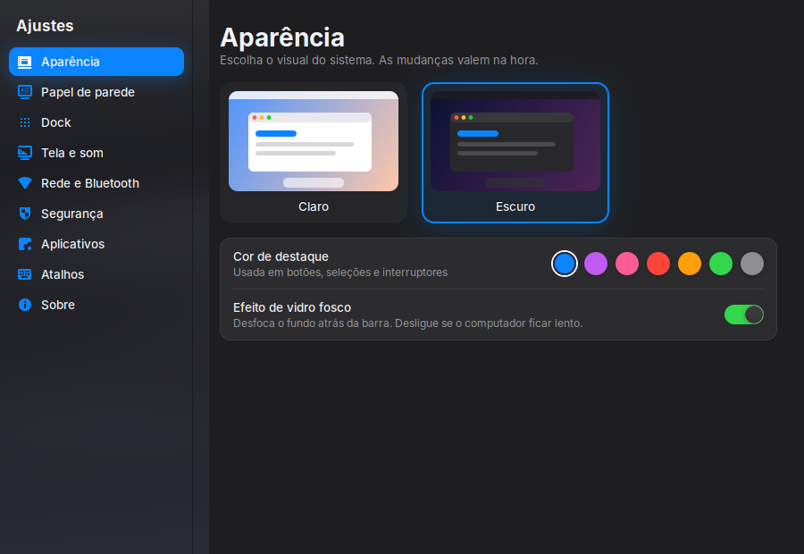
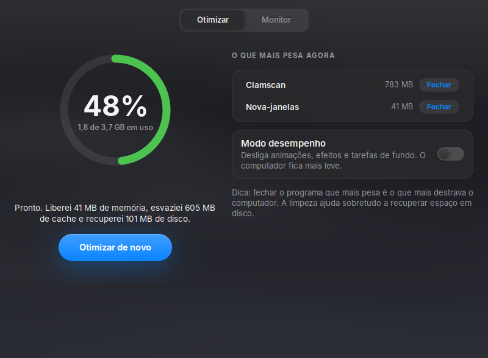

# NOVA OS

Um sistema **leve, bonito e fácil de usar** montado sobre o **Debian 13**, pensado para computadores simples e para quem **não usa terminal**: tudo se faz com cliques e textos claros em português.


## Capturas de tela

| | |
|---|---|
| **Alt+Tab com miniaturas**  | **Pré-visualização ao passar o mouse no dock**  |
| **Todos os apps**  | **Tela de login**  |
| **Ajustes**  | **Otimizador e Modo desempenho**  |

## Vantagens

- **Roda em máquina fraca.** Desenvolvido e usado num notebook com Celeron B830, 4 GB de RAM e tela 1366x768. Os apps são escritos em C (GTK3), sem Electron nem navegador embutido (exceto o WhatsApp), e há um **Modo desempenho** de um clique.
- **Visual coeso, estilo dock + barra.** Dock translúcido com Alt+Tab com miniaturas, tema claro/escuro, cor de destaque e papéis de parede próprios.
- **Loja de apps de um clique.** Instala e desinstala programas (apt e Flatpak) com barra de progresso e mensagens de erro claras, sem terminal.
- **Dock inteligente.** Passe o mouse num ícone para ver as janelas abertas daquele programa e escolher qual abrir; clique direito abre nova janela, nova aba ou janela privada.
- **Segurança de fábrica.**
  - Firewall ligado (bloqueia tudo que entra) e acesso remoto desligado.
  - Atualizações de segurança automáticas.
  - Antivírus ClamAV com proteção em tempo real nos downloads e varredura agendada.
  - Endurecimento do kernel e bloqueio de tela ao voltar do descanso.
  - Sem `sudo` sem senha: só um ajudante com ações fixas e validadas (`nova-admin`).
- **Feito para a família.** Ajustes simples, Otimizador (limpeza e desempenho), Central de controle, gravador de voz, tela de login própria.

## O que vem dentro

| Peça | Função |
|---|---|
| `nova-loja` | Loja de apps |
| `nova-apps` | Grade de todos os programas (clique direito: executar como administrador / desinstalar) |
| `nova-ajustes` | Tela, som, rede, segurança, aplicativos, atalhos |
| `nova-otimizador` | Limpeza e Modo desempenho |
| `nova-central` | Central rápida (Wi-Fi, volume, energia) |
| `nova-janelas` | Alt+Tab com miniaturas e pré-visualização no dock |
| `nova-greeter` | Tela de login (LightDM) |
| `nova-papel` | Papel de parede (inclui animado) |
| `nova-whatsapp` | WhatsApp numa janela própria |
| `nova-gravador` | Gravador de voz |

Base: Openbox + tint2 + Plank + picom.

## Requisitos

- **Computador:** qualquer PC de 64 bits com **2 GB de RAM ou mais** (testado com 4 GB e processador Celeron antigo). Quanto menos memória, mais vale ligar o **Modo desempenho**.
- **Sistema:** **Debian 13 "Trixie"** (64 bits), com internet.
- **Tela:** funciona de 1366x768 para cima.

## Instalação passo a passo

> Nunca usou Linux? Siga na ordem. Cada passo diz o que digitar.

### 1. Instale o Debian 13

1. Baixe o instalador em <https://www.debian.org/distrib/netinst> (arquivo "netinst" de 64 bits) e grave num pendrive (programas como Balena Etcher ou Rufus fazem isso).
2. Inicie o computador pelo pendrive e siga o instalador. Na escolha dos programas (**"Seleção de programas"**), **desmarque** os ambientes gráficos (GNOME, KDE etc.) e deixe marcado apenas **"utilitários padrão do sistema"**. O NOVA OS traz o ambiente gráfico dele.
3. Ao terminar, reinicie e entre com o seu usuário e senha na tela preta de texto.

### 2. Dê permissão de administrador ao seu usuário (uma vez só)

No Debian, o seu usuário ainda não pode usar `sudo`. Digite (troque `SEUUSUARIO` pelo nome que você criou):

```bash
su -
apt install sudo
usermod -aG sudo SEUUSUARIO
exit
```

Depois **saia e entre de novo** (digite `exit` e faça login outra vez) para a permissão valer.

### 3. Baixe e instale o NOVA OS

```bash
sudo apt install git
git clone https://github.com/b0mf1m-sec/NOVA-OS.git
cd NOVA-OS
./install.sh
```

O instalador:
1. instala os programas necessários (pede a sua senha, leva alguns minutos e usa a internet);
2. copia as configurações e os comandos para a sua conta (guarda as suas configurações antigas em `~/.config/nova-backup-DATA`);
3. **compila** os apps do NOVA OS (cerca de 2 a 5 minutos num computador fraco);
4. configura a tela de login, o firewall, as atualizações automáticas e o antivírus.

### 4. Reinicie e entre

```bash
sudo reboot
```

Na tela de login, digite a senha e, se aparecer um seletor de sessão, escolha **NOVA OS**.

### 5. Primeiros passos

- Clique em **Apps** (canto superior esquerdo) para ver todos os programas.
- Abra a **Loja** (no dock) para instalar navegadores, VLC, LibreOffice, jogos e mais.
- Abra **Ajustes** para escolher tema claro/escuro, cor, papel de parede e segurança.
- Atalhos úteis: **Alt+Tab** troca de janela; passe o mouse num ícone do dock para ver as janelas abertas daquele programa.

### Opções do instalador

- `./install.sh --so-usuario` instala só a parte da sua conta, sem tela de login, firewall e ajustes de sistema. Bom para **testar sem mudar o computador todo**: depois, numa sessão de texto, rode `startx`.
- `./install.sh --sem-dependencias` pula a instalação de pacotes (use se já tiver tudo).

### Atualizar

```bash
cd NOVA-OS
git pull
./install.sh --sem-dependencias
```

### Desinstalar

```bash
cd NOVA-OS
./uninstall.sh
```

Seus arquivos pessoais não são apagados.

## Problemas comuns

| Sintoma | O que fazer |
|---|---|
| A tela de login volta ao digitar a senha | Na tela de login, escolha outra sessão (ex.: Openbox) e veja o erro: `cat ~/.xsession-errors` |
| Aparece a tela de login padrão, não a do NOVA OS | Rode `sudo journalctl -u lightdm -b` e confira se `/usr/local/bin/nova-greeter-bin` existe. Se o login próprio falha, o sistema usa o login comum de propósito. |
| Sem Wi-Fi | Instale o firmware da sua placa: `sudo apt install firmware-iwlwifi` (Intel) ou `firmware-realtek`, `firmware-atheros` (precisa ativar o repositório `non-free-firmware` do Debian) |
| Sem som | Abra o controle de volume pelo ícone da barra; confira em **Ajustes → Tela e som** |
| Computador lento | Ative o **Modo desempenho** no Otimizador |
| A Loja pede senha | É normal quando o ajudante sem senha não está instalado; digite a senha do computador |

## Estrutura do repositório

```
fontes/    código dos apps (C/GTK3) e script de compilação
bin/       comandos nova-* (shell)
config/    configurações (openbox, tint2, picom, plank, dunst...)
share/     ícones, papéis de parede, temas, lançadores
sistema/   o que vai para fora da sua pasta (login, sudo restrito, sysctl, políticas do Firefox)
install.sh   instalador
uninstall.sh desinstalador
```

## Segurança: como o `sudo` funciona

O NOVA OS **não** libera `sudo` sem senha. Só `/usr/local/sbin/nova-admin` roda sem senha, com ações fixas (instalar/remover pacotes da lista da Loja, ligar/desligar firewall, etc.), validando cada argumento. Pacotes essenciais do sistema não podem ser removidos por ele. Qualquer outra coisa pede a senha.

## Aviso

Projeto pessoal, testado em Debian 13 num único notebook. O instalador altera o login e regras de sistema: leia `install.sh` antes e use em máquina que possa reconfigurar. Sem garantias.

## Licença

MIT, veja `LICENSE`.
